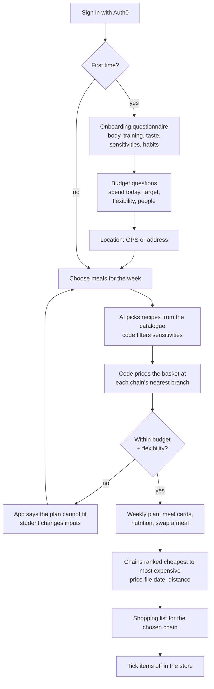

# MANAger – Product Specification

*Revised Nov 15, 2026 (previous version: Nov 1, 2026) · Team 6 les bgs*

# Changes in this version

1.  **From session summary to specification.** The document is rebuilt around the requested structure: Problem, Users, Value proposition, User flow, MVP and Success metrics. Technical content (price data, risks, team, stack, progress) moved to a separate section near the end (section 9).

2.  **User and pain defined.** Our user is a student in Jerusalem. Their pain is overspending on food ordered in and on unplanned groceries, not knowing what to cook, inefficient planning, and lack of time and energy. This is based on our own experience as students and will be validated through user interviews and the onboarding questionnaire.

3.  **User stories and full flow.** We added 18 user stories (11 in V1 core, 6 in V1.1, 1 for later) and a flow diagram covering sign-in, questionnaire, weekly planning, AI menu and prices, budget check, results, and the shopping list checked off in the store.

4.  **Success metrics.** Two primary metrics: savings per basket (cheapest chain vs. the average of the three chains) and week-2 retention (share of testers who generate a second weekly plan), plus five supporting metrics. All targets are first estimates, to be revised after the first tests with classmates and friends and again after the first 10 pilot users.

5.  **What we are not building now.** Future ideas are split into "Nice to have" (pantry items, saved baseline cart, other plan durations) and "Out of scope" (other cities, multi-store shopping, a separate FastAPI backend, alternative team split). The MVP itself is split into V1 core and V1.1, and all open decisions from October 25 are settled.

6.  **Rules clarified (new in this revision).** Budget ceiling includes the user's chosen flexibility; items without a price are handled the same way in every chain so the ranking compares identical baskets; kashrut is handled as a recipe-level rule, not only an ingredient tag; soy added to the allergen tags.

MANAger (מנה + manager) is a mobile-first web app that plans a Jerusalem student's meals for the week, builds the shopping list, and ranks Shufersal, Rami Levy and Osher Ad from cheapest to most expensive for that basket. The app is not delivery-based: it sends the student to shop in person at the nearest branch, with a ready list in hand.

# 1. Problem

Students with an unstable income overspend on food because they don't plan: they order in, eat out, buy whatever they see in the store, and throw away ingredients bought for a single dish.

The pain today, from the student's point of view:

- **No time or energy to plan.** Between classes, work and exams, "what do I eat?" is decided at the last minute, when the cheapest option is no longer on the table.

- **Not knowing what to cook.** Without a plan, the student falls back on delivery or ready-made food.

- **Inefficient planning.** Students who do plan often choose very different meals, so they buy more ingredients than needed.

- **Prices are opaque.** The same basket can cost noticeably more in one chain than another, but no student compares three chains item by item.

- **Waste.** A full package is bought for one dish; the rest is thrown away.

- **Generic advice does not fit.** Recipe apps ignore the student's budget, food sensitivities, nutritional needs, training routine, dislikes and the stores near them.

Existing tools solve only part of this: price-comparison sites compare products but do not plan meals, and recipe and nutrition apps plan meals but ignore local prices. No tool connects my goals → my meals → my shopping list → the cheapest store near me.

**Evidence and assumptions.** This description comes from the experience of the three team members, who are students themselves. It will be validated in user interviews (\[dates to add\]) and through the onboarding questionnaire: how much students spend on food per week, how many store trips they make, and how often they order in.

# 2. Target users

The first version serves one user: a university student in Jerusalem who lives outside the family home and buys and cooks their own food. Families, non-student users and other cities are out of scope for now.

| **Attribute**    | **Definition for the MVP**                                                                                                     |
|------------------|--------------------------------------------------------------------------------------------------------------------------------|
| Who              | Students aged roughly 19–30 at the Hebrew University, Bezalel, Azrieli, Hadassah Academic College and other Jerusalem campuses |
| Living situation | Dorms or shared apartments (Kiryat HaYovel, Rehavia, Nachlaot, French Hill, the student village)                               |
| Household        | Cooks for 1, sometimes 2–3 roommates                                                                                           |
| Budget           | Tight, often unstable income; price is the first decision factor                                                               |
| Cooking skill    | Basic: simple recipes, up to ~30 minutes, few utensils                                                                         |
| Stores           | Shufersal, Rami Levy or Osher Ad branches reachable on foot, by light rail or by bus                                           |

## Personas

- **Noa, 23, economics student, dorms on Mount Scopus.** Her weekly food budget is fixed; she ends the month eating pasta. Wants: a cheap week of meals without thinking.

- **Yossi, 26, engineering student, trains 4 times a week.** Needs high protein on a budget; buys chicken and cottage cheese but runs out of ideas. Wants: meals that match his training and calorie goal.

- **Maya, 21, first-year, shared apartment in Nachlaot.** Has never planned a weekly shop and throws food away. Wants: one trip, one list, nothing wasted.

# 3. Value proposition

For Jerusalem students on a tight budget, MANAger turns a two-minute profile into a week of simple meals and one shopping list, priced at the cheapest nearby chain, so they spend less, waste less and eat better. The main promise is saving money.

| **Student pain**                               | **What MANAger does**                                                                                                                       | **Why it is different**                                     |
|------------------------------------------------|---------------------------------------------------------------------------------------------------------------------------------------------|-------------------------------------------------------------|
| No time to plan                                | Builds a weekly plan for the meals the student chooses (breakfast, lunch and/or dinner) from a one-time profile                             | Personal: body, training, likes and dislikes, eating habits |
| Budget runs out mid-week                       | Asks what the student spends today, their target and how flexible it is, and builds a plan within it                                        | Savings are shown in shekels                                |
| Opaque prices                                  | Ranks the three chains from cheapest to most expensive using the price file of the branch nearest the student, and shows the distance to it | Real, legally published prices, not estimates               |
| No idea of the nutritional value of what I eat | Shows calories, protein, carbs and fat for each meal, plus a weekly summary against the target                                              | Target derived from the profile; calculated by code         |
| Sensitivities and allergies                    | Filters recipes and ingredients by what the user marked (gluten, lactose, nuts, eggs, soy, vegetarian, vegan, kashrut)                      | No recipe with a forbidden ingredient is ever suggested     |
| Waste                                          | Plans meals that reuse the same base ingredients across the week                                                                            | Fewer packages bought for a single meal                     |
| Cluttered lists                                | Leaves pantry staples (oil, salt, sugar, spices) off the list                                                                               | The list shows only what must be bought                     |

The app combines three things no single competitor does: personal nutrition, meal planning and local price comparison.

# 4. User stories

Stories marked V1 core are built this semester; V1.1 follows once V1 core passes its completion criteria; Later is in section 10.

| **\#** | **As a…**                  | **I want to…**                                                                                                                                 | **So that…**                                                      | **Priority** |
|--------|----------------------------|------------------------------------------------------------------------------------------------------------------------------------------------|-------------------------------------------------------------------|--------------|
| US1    | new user                   | create an account                                                                                                                              | the app remembers my profile and preferences                      | V1 core      |
| US2    | new user                   | answer a short onboarding (age, height, weight, sex, training routine, liked and disliked foods, meals per day, healthy vs. relaxed eating)    | the plan fits my body, goals and taste                            | V1 core      |
| US3    | student                    | answer budget questions: what I spend on food per week today, what I want to spend, how flexible the budget is, and how many people I cook for | the plan stays within what I can spend, and I see how much I save | V1 core      |
| US4    | student with a sensitivity | mark allergies and sensitivities (gluten, lactose, nuts, eggs, soy), vegetarian or vegan, and kashrut                                          | I'm never offered a recipe I can't eat                            | V1 core      |
| US5    | student                    | share my location automatically or enter an address or neighbourhood                                                                           | prices and distances come from the branches near me               | V1 core      |
| US6    | student                    | choose which meals to plan for the week (breakfast, lunch and/or dinner) and how many                                                          | the plan matches how I actually eat                               | V1 core      |
| US7    | student who trains         | see calories, protein, carbs and fat for each meal, and a weekly summary against my target                                                     | I know I'm hitting my goals                                       | V1 core      |
| US8    | student                    | swap a meal I don't like for another one                                                                                                       | the plan stays mine                                               | V1 core      |
| US9    | student                    | see the three chains ranked from cheapest to most expensive for my basket, with the distance to the nearest branch of the chain I pick         | I shop where it is cheapest and know how far it is                | V1 core      |
| US10   | student                    | see one combined shopping list, rounded to package sizes, with a price per item and a total, without oil, salt, sugar and spices               | I buy only what I need and know what it costs                     | V1 core      |
| US11   | student                    | tick items off the list while shopping at the branch                                                                                           | I don't forget anything                                           | V1 core      |
| US12   | student                    | download the shopping list                                                                                                                     | I can use it outside the app                                      | V1.1         |
| US13   | returning user             | have the app remember which meals I already had                                                                                                | my plans don't repeat the same meals                              | V1.1         |
| US14   | returning user             | get a meal suggestion when I open the app, based on the time of day and my usual meal times                                                    | I know what to make right now                                     | V1.1         |
| US15   | student                    | choose private-label vs. leading brands                                                                                                        | the list matches my budget style                                  | V1.1         |
| US16   | student                    | be offered options when I go over budget: keep the plan, switch to cheaper brands, or replace the 1–2 most expensive dishes                    | I can stay within budget without starting over                    | V1.1         |
| US17   | student                    | use the app in Hebrew                                                                                                                          | I can use it in my own language                                   | V1.1         |
| US18   | student                    | mark items I already have at home                                                                                                              | they are removed from the list                                    | Later        |

# 5. User flow

The student sets up a profile once; after that, every week goes from choosing meals to a priced shopping list in hand.

If the plan cannot fit the budget, the app says so and the student changes the inputs; the over-budget options come in V1.1.

**Noa's first week, from her point of view:**

1.  **Sunday evening, sign up.** She creates an account through Auth0.

2.  **Onboarding (~2 minutes).** Age, height, weight, sex, training routine, favourite and disliked foods, meals per day, healthy vs. relaxed eating, and sensitivities; Noa marks lactose intolerance.

3.  **Budget.** She spends about ₪300 a week today, wants to get down to ₪250, the budget is strict, and she cooks for one. (example figures)

4.  **Location.** She lets the app use her location.

5.  **Choose meals.** She picks which meals to plan for the week.

6.  **Weekly plan.** The app shows meal cards with prep time, ingredients, calories and protein per serving, and a weekly summary against her target; no recipe contains lactose. She swaps one dish she doesn't like.

7.  **Compare chains.** She sees the three chains ranked from cheapest to most expensive, with the price-file date and the distance to the nearest branch. She picks the cheapest.

8.  **Shopping list.** One list with summed quantities, rounded to packages, with a price per item and a total; oil, salt, sugar and spices are left out.

9.  **In the store.** On Monday she goes to the branch, opens the list on her phone and ticks items off as she shops.

10. **Next Sunday.** She generates the next week's plan from the same profile.

# 6. MVP scope

The MVP is split in two: V1 core is what we must deliver this semester, and V1.1 is built only once all V1 core completion criteria pass.

## V1 core

- Account and sign-in through Auth0; the profile and preferences are saved (US1).

- Full onboarding questionnaire, including body, training, taste, sensitivities, eating habits and budget questions (US2–US4; see the table below).

- Location: automatic (GPS) or entered by the user as an address or neighbourhood (US5).

- Weekly plan for the meals the user chooses: breakfast, lunch and/or dinner, as many as the user wants for one week (US6). Simple recipes (≤ 30 minutes, ≤ 8 ingredients), generated by the Claude API but restricted to a human-validated ingredient catalogue.

- Ingredient reuse: the plan prefers recipes that share base ingredients (e.g. one pack of chicken across two meals).

- Sensitivity filtering: every catalogue ingredient is tagged (gluten, dairy, nuts, eggs, soy, meat, fish, etc.), and code filters out recipes that don't fit the profile before they reach the AI (US4).

- **Kashrut:** each catalogue ingredient is tagged meat / dairy / pareve, and for users who mark kashrut, code rejects any recipe that combines meat and dairy and any non-kosher ingredient category (e.g. pork, seafood). Kosher certification of specific products is not verified in V1; the app asks the user to check the label.

- Nutritional value per meal: calories and protein on the card, carbs and fat in the details, plus a daily and weekly summary against a target derived from the profile (US7).

- Swap a single meal (US8).

- **Budget:** the plan stays within the user's budget ceiling, defined as the target budget plus the flexibility the user chose (strict = 0%, flexible = up to 10% over), or the app clearly says it cannot.

- Chain ranking: the full basket priced in Shufersal, Rami Levy and Osher Ad from the official price file of each chain's branch nearest the user, ranked from cheapest to most expensive; the cheapest is highlighted, and the app shows the distance to the nearest branch of the chain the user picks (US9).

- **Missing prices:** if an item has no price in any of the three branch files, it is excluded from every chain's total and marked "price unknown" on the list, so the ranking always compares identical baskets. The screen shows how many items are excluded.

- Shopping list for the chosen chain: one combined list, quantities summed across recipes and rounded up to real package sizes, pantry staples excluded, with a price per item and a total (US10).

- Check-off list for use while shopping at the branch (US11). No delivery: the app never places an order with the store.

- Interface in English.

## V1.1

- Downloading the shopping list (US12).

- Meal history (US13).

- "Now" suggestion on the home screen, based on the clock and the user's stated meal times (US14).

- Brand preference: private label vs. leading brands such as Osem, Tnuva, Strauss and Sugat (US15).

- Over-budget options: keep the plan, switch to cheaper brands, or let the AI replace the 1–2 most expensive dishes (US16).

- Hebrew interface (right-to-left), alongside English (US17).

- Promotions, seasons and holidays reflected in the plan.

## Onboarding questionnaire

The questionnaire is the first thing a user completes after signing in. It also serves as a research tool to validate our assumptions about students.

| **Topic**                       | **Questions**                                                                                                                                                       | **What it is used for**                                 |
|---------------------------------|---------------------------------------------------------------------------------------------------------------------------------------------------------------------|---------------------------------------------------------|
| Personal details                | Age, height, weight, sex                                                                                                                                            | Daily calorie and protein target                        |
| Training                        | Times per week, type (strength, cardio), goal (lose, maintain, gain mass)                                                                                           | Adjusts the calorie and protein target                  |
| Budget                          | How much do you spend on food per week today? How much do you want to spend? How flexible is the budget (strict / up to 10% over)? How many people do you cook for? | Budget ceiling (target + flexibility) and savings shown |
| Taste                           | Favourite foods, disliked foods                                                                                                                                     | Recipe selection                                        |
| Sensitivities and special diets | Allergies and sensitivities (gluten, lactose, nuts, eggs, soy), vegetarian / vegan, kashrut                                                                         | Filters recipes and ingredients                         |
| Eating habits                   | Meals per day and at what times, healthy vs. relaxed eating                                                                                                         | Weekly planning, and the "now" suggestion in V1.1       |

## Completion criteria (definition of done)

1.  A new user goes from sign-up to a priced shopping list in under 5 minutes.

2.  Every ingredient in every generated recipe exists in the catalogue: 0 unmatched items.

3.  All totals, quantities and nutritional values are calculated by code from the catalogue table, never by the AI; a test checks them.

4.  Prices come from price files no older than 7 days, and the screen shows the date.

5.  The plan stays within the user's budget ceiling (target + chosen flexibility), or the app clearly says it cannot.

6.  No recipe in the plan contains an ingredient that conflicts with a sensitivity or diet the user marked (including the meat-and-dairy rule for kashrut), checked by an automated test.

7.  The app runs on the course demo day from a public URL, on a phone browser.

**Non-negotiable rules:** test data is always labelled as such; the AI never invents prices or products; no feature outside V1 core is built before all seven criteria pass.

# 7. Success metrics

The north-star metric is money saved per user per week, shown in shekels and as a percentage of the three-chain average. The main health metric is week-2 return rate. The app is tested by classmates and friends, then in a pilot of 30–50 students recruited on campus during the semester.

The first two metrics are primary; the other five support them.

| **Metric**                     | **Definition**                                                                                                                   | **How we measure**         | **Pilot target (first estimate)**   |
|--------------------------------|----------------------------------------------------------------------------------------------------------------------------------|----------------------------|-------------------------------------|
| **Weekly saving (primary)**    | Basket price at the cheapest chain vs. the average price of the same basket across Shufersal, Rami Levy and Osher Ad, in ₪ and % | Calculated by the app      | Average saving ≥ 10%                |
| **Week-2 retention (primary)** | Share of users who generate a second weekly plan within 14 days of the first                                                     | App event log              | ≥ 40%                               |
| Activation                     | Share of new sign-ups who reach a priced shopping list                                                                           | Event log: sign-up → list  | ≥ 70%                               |
| Time to list                   | Median time from sign-up to priced list                                                                                          | Timestamps                 | \< 5 minutes                        |
| Plan acceptance                | Share of planned meals kept without a swap                                                                                       | Event log                  | ≥ 70%                               |
| Data quality                   | Share of list items matched to a real product with a price                                                                       | Automated check            | 100% in the catalogue, ≥ 95% priced |
| Satisfaction                   | "Would you recommend MANAger to a friend?" (0–10)                                                                                | In-app survey after week 1 | NPS ≥ 30                            |

Targets are first estimates; we will revise them after the first tests with classmates and friends, and again after the first 10 pilot users. The 10% saving target in particular may need adjusting, since it is measured against the three-chain average rather than the most expensive chain.

# 8. Business model

The app is free to start, and earns from a premium tier and, later, from retail partners; the pitch to the user is simple: premium must cost less than it saves.

| **Revenue stream**                    | **How it works**                                                                                                                                     | **When**                                       |
|---------------------------------------|------------------------------------------------------------------------------------------------------------------------------------------------------|------------------------------------------------|
| Freemium subscription                 | Free: one weekly plan and the chain ranking. Premium (a few shekels a month): unlimited swaps, pantry tracking, brand preference, multi-week history | After the MVP, once week-2 retention is proven |
| Student-union and campus partnerships | Student associations offer premium to members as a benefit; paid per seat                                                                            | After the pilot                                |
| Sponsored placement                   | Chains or brands promote relevant products or promotions inside the list, clearly labelled as sponsored and never changing the "cheapest" result     | When there is a meaningful user base           |
| Affiliate / online order              | Send the list to a chain's online cart for a referral fee. Outside the current focus, in which the user shops in person at the branch                | Later; depends on chain APIs                   |

Main costs: Claude API calls (kept low by using a small model and caching plans), hosting, and the team's time maintaining the ingredient catalogue. Open item: estimate cost per weekly plan after the first 50 generations.

# 9. Feasibility, risks and tech stack

The project is feasible because Israeli law requires supermarket chains to publish their prices online and keep them updated (VoxEU). Prices are published per branch and can differ between branches of the same chain (Mako), so the app always uses the price file of the specific branch it ranks. We located each chain's files and an open-source Python library that still needs testing.

| **Risk**                                                           | **Impact**                                     | **Response**                                                                                                                                                                              |
|--------------------------------------------------------------------|------------------------------------------------|-------------------------------------------------------------------------------------------------------------------------------------------------------------------------------------------|
| Matching recipe ingredients to store products                      | Wrong or missing prices                        | Human-validated ingredient catalogue (~150 items) mapped to product codes per chain                                                                                                       |
| Retrieving and parsing price files for the branches near each user | No live prices                                 | Cache the files of Jerusalem branches; fall back to the last valid file with its date shown                                                                                               |
| Prices differ between branches                                     | Wrong ranking                                  | Always price the basket from the nearest branch's own file, never a chain-wide price                                                                                                      |
| Item missing from a branch's price file                            | Ranking compares different baskets             | Exclude the item from every chain's total and mark it "price unknown"                                                                                                                     |
| AI unreliable with numbers                                         | Wrong totals, quantities or nutritional values | AI only picks recipes from the catalogue; every calculation is done in code and tested                                                                                                    |
| Nutrition data source                                              | Inaccurate calories and protein                | Nutritional values per 100 g for each catalogue ingredient, from one official source (candidate: the Israeli Ministry of Health nutrition database, to verify); values shown as estimates |
| Sensitivities, allergies and kashrut                               | Health or religious harm to the user           | Allergen and meat/dairy/pareve tagging in the catalogue, human-validated; filtering done in code, not by the AI; a clear notice to check the product label at the branch                  |
| Package sizes vs. recipe quantities                                | List under- or over-buys                       | Round up to the nearest package in code; ingredient reuse across recipes                                                                                                                  |
| Beginner team, one semester                                        | Unfinished app                                 | Six-phase build order in CLAUDE.md; nothing outside V1 core before the completion criteria pass                                                                                           |

**Team roles:** price data · catalogue and AI prompt · interface and integration.

**Stack:** Python, Streamlit, Claude API, Auth0 login, Claude Code in VS Code, shared GitHub repository. A first Streamlit prototype on labelled test data already exists (budget gauge, store comparison, meal cards, shopping list); we restarted from a clean base guided by CLAUDE.md, which holds the product definition, completion criteria, non-negotiable rules, the six-phase build order and a decision log.

# 10. Nice to have and out of scope

Nothing in this section is built before V1 core and V1.1 are done.

## Nice to have (later)

1.  Pantry items already at home, removed from the list (US18).

2.  Saved baseline cart with live editing and instant price recalculation.

3.  Plan durations other than one week.

## Out of scope (not planned for this course)

- Other cities (Tel Aviv, Ashdod) and other chains: they multiply the product-matching work, our main bottleneck.

- Families and non-student users.

- Splitting the basket across several chains: the user shops at one chain.

- A separate FastAPI backend and web frontend: too complex for this team until Streamlit hits a real limit.

- An alternative team split (AI agent and pricing engine in one role, catalogue organised by price tier).

- Online ordering, delivery or store pick-up: the user shops in person at the branch.

- Medical or clinical nutrition advice: the app gives general guidance only, and users with a severe allergy must check the product label.

# 11. Decision log

All decisions left open on October 25 are now settled.

| **Topic**                        | **Decision**                                                                                               |
|----------------------------------|------------------------------------------------------------------------------------------------------------|
| Single vs. multi-store shopping  | One chain per basket                                                                                       |
| Which branches                   | The branch of each chain nearest the user, located by GPS or by address (no fixed neighbourhood)           |
| Meals                            | The user chooses breakfast, lunch and/or dinner for one week                                               |
| Interface language               | English in V1 core; Hebrew added in V1.1                                                                   |
| Over budget                      | V1 core: the app says the plan cannot fit; V1.1: three options                                             |
| Budget ceiling                   | Target budget + the flexibility the user chose (0% or up to 10%)                                           |
| Rounding to package sizes        | Rounded up, calculated in code                                                                             |
| Items without a price            | Excluded from every chain's total and marked "price unknown"                                               |
| Kashrut                          | Recipe-level rule (no meat with dairy, no non-kosher categories); product certification not verified in V1 |
| "Now" suggestion                 | V1.1, based on the clock and stated meal times                                                             |
| Promotions, seasons and holidays | V1.1                                                                                                       |
| Savings baseline                 | Average of the three chains                                                                                |

**Still open:** the cost per weekly plan (to estimate after 50 generations), the nutrition data source (to verify), and testing the open-source price-file library.

# Sources

- Supermarket transparency lowers prices — VoxEU

- Price gaps between supermarket branches — Mako
